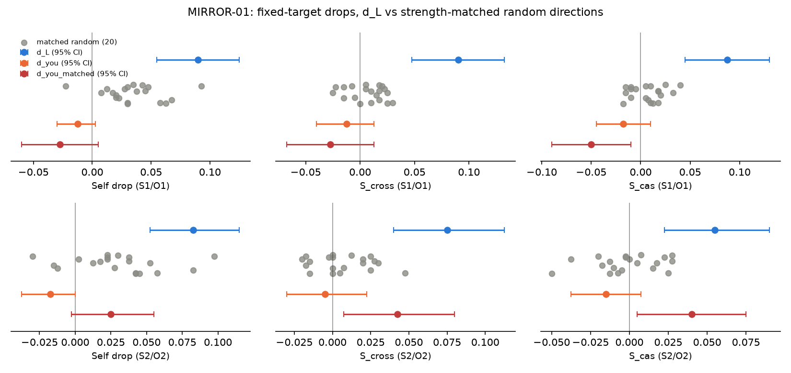

# MIRROR-01 report — Prediction Without Moving the Target, 2026-11-09

**Verdict (mechanical rule, primary S1/O1): H3.** The gate passes. d_L's self-prediction drop with a fixed target
is +0.090 [0.055, 0.125], so its CI excludes 0, but it is **not larger than every strength-matched random
direction**: one of the 20 (random_1017) gives +0.0925, one item more out of 400. Under the pre-registered rule that
alone makes H3 the verdict, and the H1/H2 conditions are not reached. The secondary wording (S2/O2) gives the same
verdict (H3), so the verdict is **not fragile**. Per the protocol's pre-agreed consequences, this direction-based line of
work is closed and written up as a negative result.

The H3 verdict should be read narrowly. It comes from the second clause of the rule ("not larger than every
random self drop"), not from the first ("CI includes 0"). The other numbers do not show a d_L effect that vanishes
once the target is fixed; section 6 sets out what they show. None of that changes the verdict.

Protocol: `protocol_01.md` (frozen before any MIRROR-01 data; no amendments). Nothing here concerns consciousness,
subjective experience or self-awareness. The question is narrow and mechanical.

## 1. Question
Does removing MIRROR-00's candidate direction d_L disrupt Qwen's ability to predict its own answer when the answer
itself does not change? If so, is the disruption specific to self-prediction, or general to prediction?

## 2. What was fixed in advance
- Model A = Qwen3-4B-Instruct-2507 @ cdbee75f (the only hooked model); B = Gemma-4-E4B-it (never hooked). bf16, greedy,
  thinking off, batch size 1, cached decoding, seed 0. Object answers max 16 new tokens, predictions max 8.
- d_L, d_you, L = 12 and α = 2.0 from `../stage3_selection.json` and `../stage3_directions.pt` (asserted in code).
- Hook h ← h − α (h·d) d on the output of block 12, at every position of the **prediction prompt only** (prefill and
  every decoding step). Object answers for A and B were generated with no hook at all.
- S1/O1 (primary) and S2/O2 (secondary) wordings, format lines and parsers unchanged from MIRROR-00 (`scripts/prompts.py`,
  `scripts/parsers.py`). Property: first letter only.
- Strength matching computed and saved **before any new item was run** (`strength_matching.json`, 12:21:52 UTC).
- Scoring, gate, decision rule and fragility rule were written into `scripts/mirror01_score.py` while the generations
  were running, before any MIRROR-01 output was inspected.

## 3. Dataset (`data/dataset_01.csv`, `scripts/mirror01_make_dataset.py`, seed 101)
- **400 items, all held out:** 300 open choices (12 categories × 25: animal, bird, dish, vegetable, fruit, city,
  country, given name, musical instrument, sport, profession, vehicle; 5 new templates × 10 new qualifiers per
  category) and 100 short completions (new determiners, adjectives and nouns; 3 new templates).
  No factual items.
- Completion prompts were rewritten to end with "Reply with only the missing word and nothing else." Choice prompts
  keep the MIRROR-00 task suffix and format line.
- **Overlap with MIRROR-00 (`data/dataset.csv`, 500 tasks): 0 task strings, 0 object prompts, and no new task begins
  with a MIRROR-00 template opening** (`dataset_check.json`).

Descriptives (unhooked object answers, `metrics.json` → `descriptives`):

| | A (Qwen) | B (Gemma) |
|---|---|---|
| Object answers with a valid first letter | 400/400 | 400/400 |
| Multi-word (noncompliant) answers | 10.0% | 0.75% |
| Completion echo, strict rule (multi-word, first word repeats the phrase's first word) | 10/100 | 0/100 |
| Completion echo, broad rule (first word is any word of the phrase, or the answer contains the phrase) | 11/100 | 0/100 |
| Distinct first letters / most common letter | 23 / B (0.110) | 22 / S (0.120) |

A and B give the same first letter on 46% of items. Echoing items are kept and flagged, as the protocol requires; the strict-rule
rate is lower than on the MIRROR-00 test completions (14/50 at baseline, `../stage5_report.md`), but not zero.
Class balance: A's most frequent letters are B 44, P 43, T 41, S 33, C 32; the frequency-weighted random baseline is 0.068.

## 4. Strength matching (`strength_matching.json`, `scripts/mirror01_strength.py`)
m(d) = mean |h·d| at block 12 over every position processed while A generated its S1 predictions for the 114
MIRROR-00 dev-fit items (8,127 positions; one unhooked pass with measure-only hooks; the 114 outputs were identical to
Stage 2). m(d_L) = 6.047, m(d_you) = 2.049, random m = 0.775–2.974. α_r = 2·m(d_L)/m(d_r): random α 4.14–15.61,
d_you matched α = 5.902. **No α reached the cap of 20.**

Mean |h·d| removed per position on the MIRROR-01 prediction prompts (α × mean |h·d|, `run.json`):
d_L 10.69 (|h·d| 5.35); d_you 3.86; d_you matched 11.39; matched random 11.17–12.88. The matching was done on
MIRROR-00 prompts, as the protocol specifies. On the new prompts it holds to within about 20%, and every matched
random direction removes slightly **more** than d_L.

## 5. Results — primary wording (S1/O1), n = 400 (all items eligible for every measure)
Drops = baseline − condition, paired over items; 95% percentile bootstrap CIs, 10,000 resamples, seed 0.
Baseline: **self 0.347, cross 0.247, cas 0.280.**

| Condition | Self acc | Self drop [95% CI] | Cross drop [95% CI] | Cas drop [95% CI] | S_cross [95% CI] | S_cas [95% CI] |
|---|---|---|---|---|---|---|
| **d_L** (α 2) | 0.258 | **+0.090** [0.055, 0.125] | +0.000 [−0.028, 0.028] | +0.003 [−0.030, 0.035] | **+0.090** [0.048, 0.133] | **+0.087** [0.045, 0.130] |
| d_you (α 2) | 0.360 | −0.013 [−0.030, 0.003] | +0.000 | +0.005 | −0.013 [−0.040, 0.013] | −0.018 [−0.045, 0.010] |
| d_you matched (α 5.90) | 0.375 | −0.028 [−0.060, 0.005] | +0.000 | +0.022 | −0.028 [−0.068, 0.013] | −0.050 [−0.090, −0.010] |
| Matched random ×20: range | 0.255–0.370 | −0.023 to +0.093 | −0.015 to +0.073 | −0.028 to +0.083 | −0.025 to +0.030 | −0.018 to +0.040 |
| Matched random ×20: mean | | +0.034 | +0.028 | +0.027 | +0.007 | +0.007 |
| random_1017 (α 13.46), largest random self drop | 0.255 | +0.0925 [0.055, 0.130] | +0.073 [0.038, 0.110] | +0.083 [0.043, 0.123] | +0.020 [−0.030, 0.070] | +0.010 [−0.035, 0.055] |

The gate and the rule are applied in section 7. The distribution of the random-direction drops is plotted in
`random_distribution.png`:

Prediction validity: S1 1.000 in every condition; O1 1.000 at baseline, 0.998 under d_L, 0.983–1.000 under
random directions. At baseline A gives the **same letter for itself and for Gemma on 63.5% of items** (S1/O1; 76.5% with S2/O2).
Under d_L, A's raw S1 output changes on 60.5% of items and its O1 output on 36.2%.

By category (baseline, information only): self accuracy 0.413 on choices (n = 300), 0.150 on completions (n = 100).

## 6. What the primary numbers show, beyond the verdict
- **The self drop survives a fixed target.** The answers no longer move, and d_L still lowers self-prediction by
  9 points, about the size of the MIRROR-00 test self drop (+0.089). So the MIRROR-00 effect cannot be put down entirely to moving answers.
- **But strength-matched random directions also lower self-prediction.** 9 of the 20 have a self-drop CI whose lower
  bound lies above 0, and one (random_1017) matches d_L. Once the edit is as large as d_L's, a 9-point self drop is not
  unique to d_L. This is the clause that decides H3.
- **The pattern differs.** Random directions lower self, cross and cas together (S_cross and S_cas near 0, at most
  +0.030 and +0.040). d_L lowers self only: cross and cas do not move, and S_cas = +0.087 exceeds every random S_cas.
  The matched d_you lowers nothing. The protocol gives these numbers no role once H3 holds. They are reported because they are
  the largest difference between d_L and the random directions, and they are not a finding of self-specificity.

## 7. Gate and decision rule (primary, S1/O1)
| Step | Number | Result |
|---|---|---|
| **Gate**: baseline self accuracy CI lower bound > majority-class share of A's letters | 0.347 [0.300, 0.395] vs 0.110 (letter B) | **pass** |
| H3 clause 1: self_drop CI includes 0 | [0.055, 0.125] | no |
| H3 clause 2: self_drop not larger than every matched random self_drop | 0.090 vs max 0.0925 (random_1017); rank 2 of 21 | **yes → H3** |
| (H1 conditions, recorded but not reached) S_cas CI > 0; S_cross CI > 0; S_cas > all random; matched d_you self drop < half d_L | [0.045, 0.130]; [0.048, 0.133]; 0.087 vs max 0.040; −0.028 < 0.045 | all four would hold |

**Verdict: H3.** The margin is one item out of 400 (36 vs 37 items lost), and the rule specifies no tie or margin
handling, so the verdict stands as computed. Had d_L ranked first, the recorded H1 conditions would all have held.
That is a counterfactual about a pre-registered rule, it does not change the outcome, and it is not evidence for H1.

## 8. Secondary wording (S2/O2) and fragility
Baseline: self 0.318, cross 0.220, cas 0.270. Gate: 0.318 [0.273, 0.363] > 0.110 — pass.

| Condition | Self drop [95% CI] | Cross drop | Cas drop | S_cross [95% CI] | S_cas [95% CI] |
|---|---|---|---|---|---|
| **d_L** | **+0.083** [0.053, 0.115] | +0.007 | +0.028 | +0.075 [0.040, 0.113] | +0.055 [0.023, 0.090] |
| d_you (α 2) | −0.018 [−0.038, 0.000] | −0.013 | −0.003 | −0.005 [−0.030, 0.023] | −0.015 [−0.038, 0.008] |
| d_you matched | +0.025 [−0.003, 0.055] | −0.018 | −0.015 | +0.043 [0.008, 0.080] | +0.040 [0.005, 0.075] |
| Matched random ×20: range | −0.030 to +0.098 | −0.018 to +0.073 | −0.028 to +0.100 | −0.020 to +0.048 | −0.050 to +0.028 |

Rule: self drop CI excludes 0, but d_L ranks 3 of 21 (random_1017 +0.098, random_1016 +0.0825, exactly equal to d_L's
+0.0825, which counts against d_L under the strict rule) → **H3**. (The recorded H1 conditions would again all hold: S_cas 0.055 > max random 0.028; matched
d_you 0.025 < 0.041.) Fragility rule (fixed in `mirror01_score.py` before scoring): the verdict is fragile if the S2/O2
verdict differs from the S1/O1 verdict. **H3 = H3 → not fragile.**

## 9. Exploratory: MIRROR-00 re-scored with fixed targets (NOT part of the decision)
This data had already been seen, so the following is exploratory only. Source: `../stage4_dev_raw.csv` (dev) and `../stage5_test_raw.csv` (test);
A's S1/O1 predictions under each condition are scored against A's **unhooked** answer (`A_target_base`); cross stays
against Gemma. In MIRROR-00 the predictions were generated in separate prompts, so they do not depend on that
condition's object answers. MIRROR-00's 10 random directions were **not** strength-matched. Output:
`exploratory_m00_rescore.json`.

| MIRROR-00, d_L (S1/O1) | Self drop [95% CI] | Cross drop | Cas drop | S_cross [95% CI] | S_cas [95% CI] | Random self drop range |
|---|---|---|---|---|---|---|
| Dev, all (190) | +0.037 [−0.016, 0.090] | +0.047 | +0.032 | −0.011 [−0.068, 0.047] | +0.005 [−0.047, 0.058] | −0.032 to +0.026 |
| Test, all (190) | +0.053 [0.005, 0.100] | +0.058 | +0.058 | −0.005 [−0.068, 0.058] | −0.005 [−0.063, 0.053] | −0.016 to +0.021 |
| Dev, non-factual (150) | +0.053 [−0.007, 0.113] | +0.033 | +0.013 | +0.020 [−0.047, 0.087] | +0.040 [−0.020, 0.100] | −0.027 to +0.033 |
| Test, non-factual (150) | +0.053 [−0.007, 0.113] | +0.053 | +0.053 | 0.000 [−0.073, 0.073] | 0.000 [−0.067, 0.067] | −0.013 to +0.027 |

With fixed targets, MIRROR-00's d_L self drop shrinks from +0.105 (dev) / +0.089 (test) to +0.037 / +0.053. It still
exceeds all 10 unmatched random drops in every set, and on test all its CI lies just above 0. Its S_cross and S_cas are
near 0 on test. About half of the original MIRROR-00 self drop therefore came from answers moving, and in the
re-scored data there is no sign of selectivity. On the MIRROR-01 items, with the rewritten completion prompts, d_L does
show selectivity (S_cas +0.087), though random directions match its self drop. The two sets of items and prompts
differ, and these numbers do not say why the results disagree.

## 10. Limitations
- The verdict turns on one item (36 vs 37 of 400). Twenty random directions give a coarse null: "larger than all 20" is at best p ≈ 1/21.
- Strength was matched on MIRROR-00 prompts. On MIRROR-01 prompts, matched random directions removed 4–20% more
  than d_L, which slightly favours the random directions in the self-drop comparison. The protocol specified this
  procedure, and it was followed.
- Matched random directions use α up to 15.6, an edit of quite another kind from d_L's α = 2 reflection. "Matched" refers only to the mean |h·d| removed.
- Zero-shot. One hooked model, one comparison model, first letter only, greedy bf16 decoding, a single seed.
  A and B share the first letter on 46% of items, and A gives the same prediction for both frames on 63.5% of items,
  so self and cross predictions are largely the same computation (the limitation stated in advance).
- 10% of A's completion answers still echo the phrase. Completion self accuracy is low (0.150).
- No factual-accuracy or perplexity checks were run. MIRROR-01 does not edit object answers, and the protocol does not ask for them.

## 10b. Independent verification (lead analyst, from `scored_items.csv`)
- All primary drops, the d_L S_cas CI [0.045, 0.130], the random_1017 margin (37 vs 36 items), the zero task and
  prompt overlap with MIRROR-00 (400 items, no duplicates), and the validity counts were recomputed independently and match.
- Paired difference between d_L's and random_1017's self drops: −0.0025 [−0.028, 0.022]. The ranking that decides H3 is
  statistically indistinguishable from a tie. random_1017 also lowers cross (+0.073) and cas (+0.083); d_L does not.
- Exploratory check of one mechanistic idea, "d_L makes self-predictions behave like Gemma-predictions": agreement between
  the S1 predictions and the baseline O1 predictions **falls** under d_L (0.635 → 0.562). The idea is not supported.
- **Post-hoc observation about the rule itself (not a change to the verdict).** H3's second clause was meant to catch
  "no effect beyond chance". With strength-matched random edits as large as α = 15.6, though, some random directions
  degrade *all* predictions, and the clause counts that general damage against d_L. In hindsight, a rule comparing
  selectivity (S_cas) against the random directions would have tested the hypotheses more directly. This was not
  pre-registered, and it is noted only so that any future design can avoid it.

## 11. What follows (pre-agreed in the protocol)
H3 → **close this direction-based line of work and write up the negative result.** No second hooked model is
started. The selectivity pattern in section 6 and the MIRROR-00 re-scoring in section 9 are recorded so that the
write-up can describe them accurately. They are not grounds for continuing under this protocol.

## Files
`scripts/mirror01_make_dataset.py`, `mirror01_strength.py`, `mirror01_run.py`, `mirror01_score.py`,
`mirror01_rescore_m00.py`; `data/dataset_01.csv`; in `results/mirror01/`: `dataset_check.json`,
`strength_matching.json`, `objects.csv`, `predictions.csv`, `gens_checkpoint.json` (the same generations, as the run's
checkpoint), `run.json`, `scored_items.csv`, `metrics.json`, `random_distribution.png`, `exploratory_m00_rescore.json`,
and the logs `strength_log.txt`, `run_log.txt`, `score_log.txt`, `rescore_m00_log.txt`.

## Run facts
39,200 generations (B 400 object answers; A 400 object answers + 24 conditions × 4 wordings × 400 predictions).
Generation 2,318.9 s (B session 61 s, A session 2,257 s, about 91–95 s per condition); strength matching 13.6 s. Peak
VRAM 15.9 GB (B), 8.1 GB (A). One model on the GPU at a time.

## Engineering decisions
- m(d) is measured over all positions processed during greedy generation of the S1 predictions (prefill + decoding,
  max 8 tokens), the same scope over which the hook acts and over which |h·d| is reported. All 22 directions were
  measured in one pass with measure-only (α = 0) hooks, which leave the output unchanged; the outputs were identical to Stage 2.
- Random directions: `stage4_interventions.random_dir(seed)` (torch.Generator Gaussian, unit norm) with seeds 1001–1020.
- Baseline predictions run under a measure-only d_L hook (as in MIRROR-00 Stages 4–5), to record |h·d_L|.
- All four wordings (S1/O1/S2/O2) were generated under every condition, including the random ones, so that S2/O2
  could be given "the same analysis".
- Eligibility per measure: self and cas need a valid A letter, cross a valid Gemma letter, and S_cross the items
  eligible for both. All 400 items were eligible for everything, so this had no effect.
- Fragility: the S2/O2 analysis uses its own gate (S2 self accuracy) and the same rule. Fragile = a different verdict,
  where a failed secondary gate would also count as a different verdict.
- "Larger than every random" is strict (>). Ties go against d_L, as in MIRROR-00.
- Echo rules: the strict rule is the Stage 5 rule; the broad rule was added as a second count. Both were fixed before
  scoring.
- Choice tasks keep MIRROR-00's "Answer with one word only." suffix plus the unchanged W1 format line. Completion
  prompts use only the new protocol line.
- Item ids `m1ch###` (choice) and `m1co###` (completion).
