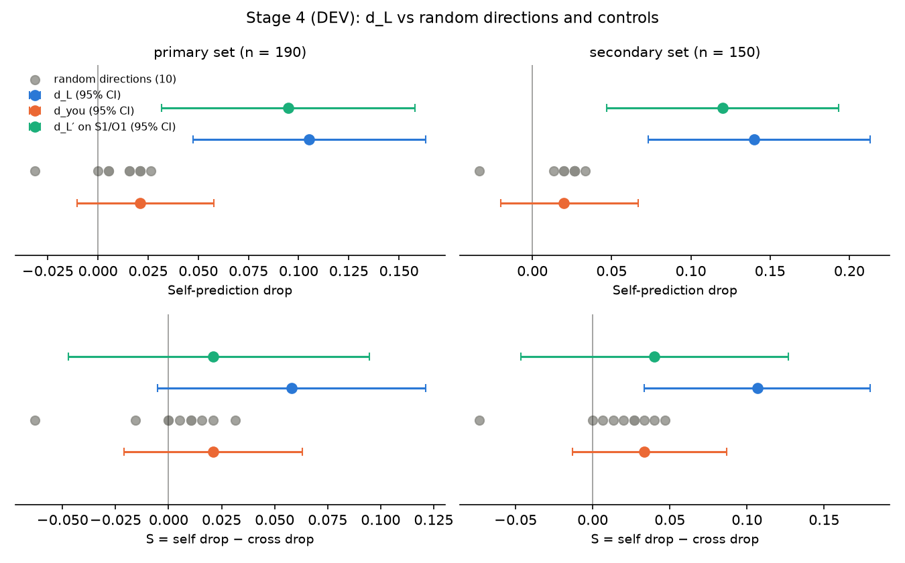

# Stage 4 report — interventions and controls (DEV split only), 2026-11-09

**Everything here is DEV evidence. It is not the final test verdict.** The protocol's decision rule applies to the
held-out test (Stage 5), which has not been run. No test item has been run through any model.

**Short version.** Removing the candidate direction d_L (block 12, α = 2) lowers A's self-prediction accuracy by
10.5 points (primary set) and 14.0 points (non-factual set). That drop is larger than for any of 10 random directions
and much larger than for the second-person control d_you, with no cost to factual accuracy or perplexity. But the
selective measure S is not clearly above 0 on the primary set (+0.058, CI [−0.005, 0.121]), and the cross-as-self
diagnostic drops **exactly as much as self-prediction does** (0.105 vs 0.105). Most of the effect comes from d_L
changing A's *object answers* (above all, it stops A echoing the phrase in completion items) while A's predictions
do not follow the change. On dev, this looks like a direction that shifts what A answers more than one that carries
self-specific information used for prediction.

Files: `scripts/stage4_interventions.py`, `scripts/interventions.py`; `results/stage4_dev_raw.csv` (per item ×
condition), `stage4_dev_metrics.json`, `stage4_run.json`, `stage4_log.txt`, `stage4_random_distribution.png`,
`stage4_sweep_and_cosines.png`. Every number below comes from these files.

## 1. What was run
- **Fixed setting** from `stage3_selection.json`: block **L = 12**, **α = 2.0** (h ← h − 2 (h·d) d at the output of
  block 12, every position, prefill and cached decoding). Frozen before this stage ran.
- **Items:** all 190 dev first_letter items (primary); the 150 non-factual items (secondary, Amendment 3).
- **Conditions** (each regenerates A's object answers, self and cross predictions under the hook; greedy, cached,
  bf16, batch size 1): baseline; d_L; random directions with seeds 1–10; d_you; d_L′ removed, scored on S1/O1
  (transfer); d_L removed, scored on S2/O2 against the S2/O2 baseline (paraphrase). Factual accuracy (40 dev factual
  items) and neutral-text perplexity (Stage 2 procedure) under every hook.
- **Scoring:** self = S1 prediction vs A's own object answer *in that condition*; cross = O1 prediction vs Gemma's
  Stage 2 dev answer; cross-as-self = O1 prediction vs A's own answer in that condition (Amendment 3). Drops are
  baseline − condition (positive = worse). S = self drop − cross drop. Paired bootstrap over items, 10,000
  resamples, seed 0, percentile 95% CIs.
- **Check:** the baseline reproduced Stage 2 exactly (950/950 outputs identical).
- **Validity:** all object answers had a valid first letter in every condition (all 190 items eligible everywhere).
  Prediction validity 0.979–1.000 (self) and 0.984–1.000 (cross) across conditions.

## 2. Results — primary set (all 190 dev first_letter items)
| Condition | Self acc | Cross acc | Self drop [95% CI] | Cross drop [95% CI] | **S** [95% CI] | Cross-as-self | Factual | PPL (rise) | Answer change | Mean \|h·d\| |
|---|---|---|---|---|---|---|---|---|---|---|
| Baseline | 0.442 | 0.326 | — | — | — | 0.389 | 0.950 | 13.89 | — | 5.76 (d_L, unedited) |
| **d_L** | **0.337** | 0.279 | **+0.105** [0.047, 0.163] | +0.047 [0.011, 0.084] | **+0.058** [−0.005, 0.121] | 0.284 | 0.950 | 13.98 (+0.6%) | 0.29 | 5.76 |
| Random ×10: range | 0.416–0.474 | 0.295–0.342 | −0.032 to +0.026 | −0.016 to +0.032 | −0.063 to +0.032 | 0.337–0.379 | 0.950 | 13.84–14.31 (≤ +3.0%) | 0.06–0.31 | 0.97–6.49 |
| Random ×10: mean | | | +0.010 | +0.008 | +0.002 | | | | 0.12 | 2.17 |
| d_you | 0.421 | 0.326 | +0.021 [−0.011, 0.058] | 0.000 [−0.032, 0.032] | +0.021 [−0.021, 0.063] | 0.389 | 0.950 | 13.85 (−0.3%) | 0.14 | 2.15 |
| d_L′ on S1/O1 (transfer) | 0.347 | 0.253 | +0.095 [0.032, 0.158] | +0.074 [0.026, 0.126] | +0.021 [−0.047, 0.095] | 0.247 | 0.975 | 14.74 (+6.2%) | 0.41 | 8.50 |
| Baseline, S2/O2 | 0.411 | 0.326 | — | — | — | 0.379 | 0.950 | 13.89 | — | — |
| d_L, S2/O2 (paraphrase) | 0.337 | 0.321 | +0.074 [0.021, 0.132] | +0.005 [−0.032, 0.042] | +0.068 [0.011, 0.132] | 0.326 | 0.950 | 13.98 (+0.6%) | 0.29 | 5.76 |

Cross-as-self drop under d_L: **+0.105 [0.047, 0.163]**; self drop − cross-as-self drop = **0.000 [−0.053, 0.053]**.
Answer change = share of object answers whose text differs from baseline; the first letter changed on 24.2% of
items under d_L (random 3.7–18.4%, d_you 8.4%). Mean |h·d| = mean projection on the removed direction at block 12
over all positions during generation, before the edit; the amount removed per position is α × that (11.5 for d_L).

## 3. Results — secondary set (150 non-factual items: choice + completion)
| Condition | Self acc | Cross acc | Self drop [95% CI] | Cross drop [95% CI] | **S** [95% CI] | Cross-as-self | Answer change |
|---|---|---|---|---|---|---|---|
| Baseline | 0.333 | 0.200 | — | — | — | 0.273 | — |
| **d_L** | **0.193** | 0.167 | **+0.140** [0.073, 0.213] | +0.033 [−0.007, 0.073] | **+0.107** [0.033, 0.180] | 0.167 | 0.37 |
| Random ×10: range | 0.300–0.367 | 0.160–0.220 | −0.033 to +0.033 | −0.020 to +0.040 | −0.073 to +0.047 | 0.213–0.267 | 0.07–0.38 |
| Random ×10: mean | | | +0.019 | +0.005 | +0.014 | | 0.15 |
| d_you | 0.313 | 0.213 | +0.020 [−0.020, 0.067] | −0.013 [−0.047, 0.020] | +0.033 [−0.013, 0.087] | 0.287 | 0.17 |
| d_L′ on S1/O1 | 0.213 | 0.120 | +0.120 [0.047, 0.193] | +0.080 [0.020, 0.140] | +0.040 [−0.047, 0.127] | 0.107 | 0.51 |
| Baseline, S2/O2 | 0.287 | 0.173 | — | — | — | 0.240 | — |
| d_L, S2/O2 | 0.173 | 0.167 | +0.113 [0.047, 0.180] | +0.007 [−0.033, 0.047] | +0.107 [0.040, 0.180] | 0.173 | 0.37 |

Factual accuracy, perplexity and |h·d| are model-level and the same as in section 2. Cross-as-self drop under d_L:
+0.107 [0.040, 0.173]; self drop − cross-as-self drop = +0.033 [−0.020, 0.087].

## 4. Random-direction distribution

d_L ranks **first of 11** on both self drop and S, in both sets. Its self drop (0.105 / 0.140) is about four times the
largest random self drop (0.026 / 0.033). Its S (0.058 / 0.107) is above the largest random S (0.032 / 0.047), but
three random directions have an S CI excluding 0 on their own (random_2 negative; random_4 and random_10 positive in
the secondary set), which shows how noisy S is at n = 150–190.

Projection size matters and differs: d_L removes a mean |h·d| of 5.76 (× 2), random directions 0.97–6.49 (mean 2.17),
d_you 2.15. The fairest random comparison is **random_5** (|h·d| 6.49, larger than d_L): it changes 31% of object
answers, much like d_L (29%), but its self drop is only +0.005 and its S −0.016. So the size of the edit and the
answer-change rate alone do not produce d_L's self drop.

The selection sweep and the cosines from Stage 3 are in `stage4_sweep_and_cosines.png`.

## 5. Where the effect comes from (diagnostics, not part of the decision rule)
1. **Cross-as-self moves with self.** Under d_L, A's O1 predictions scored against A's own (intervened) answers lose
   exactly as much as its S1 predictions (primary 0.105 vs 0.105; secondary 0.107 vs 0.140, difference CI includes 0).
   Under Amendment 3 this means the effect is **not specific to the self-framing**: whatever d_L removes, it affects
   how well A's predictions in *either* frame match A's own answers.
2. **d_L changes the object answers, and the predictions do not follow.** On the 46 items whose first letter changed
   under d_L, self accuracy falls from 0.261 to 0.065; on the 144 unchanged items it falls from 0.500 to 0.424
   (cross 0.403 → 0.347, cross-as-self 0.417 → 0.354 on the same items). Most of the self drop is therefore on
   items where the target moved.
3. **The biggest single change is the completion echo.** At baseline A repeats the phrase in 40% of completion
   answers (Stage 2 report); under d_L only 4% (2 of 50). 54% of completion first letters change, and completion
   self accuracy falls from 0.26 to 0.06. A's predictions kept tracking the old pattern (often "E" for an
   "Every …" echo it no longer produces).
4. **Why S is positive although the effect is not self-specific.** Self is scored against a target that moves with
   the intervention; cross is scored against Gemma's fixed answers. When d_L changes A's answer, self accuracy can
   collapse, but cross accuracy on those items was already near the floor (0.087 on the changed items) and cannot
   drop much. Part of S is this scoring asymmetry rather than selective impairment of self-prediction.
5. **In-sample component.** d_L was fitted on 114 of these 190 items (dev-fit). The d_L self drop is 0.132 on dev-fit
   items and 0.066 on the 76 dev-select items (cross 0.061 and 0.026). Stage 5 on test is the only clean estimate.
6. **Paraphrase.** d_L also lowers self accuracy with the S2/O2 wording (+0.074 primary, +0.113 secondary) and there
   the cross drop is near zero, giving S CIs above 0 in both sets. The direction fitted on S2/O2 (d_L′, cosine 0.66
   with d_L at block 12) also lowers self accuracy on S1/O1 (+0.095), but lowers cross accuracy almost as much, so its
   S is near zero, and it costs more perplexity (+6.2%).
7. **d_you** (cosine 0.13 with d_L at block 12) has small, non-significant effects everywhere, but its mean
   projection is 2.6× smaller than d_L's, so "less than half the drop" is partly a smaller edit.

## 6. Decision criteria (a)–(e) on DEV — indicative only, not the Stage 5 verdict
| Criterion | Primary (190) | Secondary (150) |
|---|---|---|
| (a) self drop under d_L, 95% CI excludes 0 | **holds**: +0.105 [0.047, 0.163] | **holds**: +0.140 [0.073, 0.213] |
| (b) self drop larger than all 10 random drops | **holds** (max random +0.026) | **holds** (max random +0.033) |
| (c) S CI excludes 0 **and** S > all 10 random S (Amendment 1) | **fails**: S +0.058 [−0.005, 0.121]; S > all random holds | **holds**: S +0.107 [0.033, 0.180]; max random 0.047 |
| (d) factual drop ≤ 5 pts and PPL rise ≤ 10% | **holds** (0 pts; +0.6%) | same |
| (e) d_you self drop < half the d_L self drop | **holds** (0.021 < 0.053) | **holds** (0.020 < 0.070) |
| Paraphrase (S2/O2), fragility check | effect persists: self drop +0.074, S +0.068 [0.011, 0.132] | +0.113, S +0.107 [0.040, 0.180] |

Read literally, the primary dev pattern is the protocol's **"Refine"** pattern ((a), (b) hold; (c) fails), and the
secondary dev pattern meets all five criteria. The decision rule applies to test, and the primary analysis governs.
The diagnostics in section 5 weigh against a self-specific reading even where the criteria hold: cross-as-self
falls as much as self, and much of S comes from d_L changing A's answers (notably the completion echo) under a
scoring rule whose self target moves while the cross target does not.

What the dev evidence supports: removing d_L at block 12 has a larger effect on how well A's first-letter predictions
match A's own answers than 10 random directions of comparable or larger projection, without measurable damage to
factual accuracy or perplexity. What it does not support: that d_L carries information A uses specifically to model
*itself*. Even a clean selective effect would be evidence about a causal contribution of this direction to
self-prediction, not about self-awareness or subjective experience.

## 7. Caveats
- DEV only; d_L was fitted on 60% of these items and (L, α) selected on the other 40%, so Stage 4 is partly in-sample.
- n = 190 / 150; one item changes an accuracy by 0.5–0.7 points. Ten random directions give a coarse null; "larger
  than all 10" corresponds to p ≈ 1/11 at best.
- Selection on dev-select was itself close to null (Stage 3 report: the chosen S was +0.039, CI [−0.053, 0.132]), so
  the chosen layer may not be the best one; the effect size here may regress on test.
- Greedy decoding, one seed, one hooked model, one B model, first_letter only. Completion targets measure the echoed
  first word when A echoes the phrase (Amendment 3, item 5), which drives a large part of the effect.
- The hook is applied to the prediction prompts too, so a drop can come from changed answers, changed predictions,
  or both; section 5 separates these only descriptively.

## 8. Engineering decisions
- Random directions: `torch.randn(2560)` from a CPU `torch.Generator` seeded 1–10, normalised; the same directions
  are used at block 12 only.
- Baseline uses a measure-only hook (α = 0, returns the output untouched) on d_L to record the natural |h·d_L|;
  outputs were identical to Stage 2 (950/950).
- The d_L run generates S1, O1, S2 and O2 predictions in one pass; the paraphrase condition reuses the d_L object
  answers (same hook, same deterministic generation) and the baseline's S2/O2 predictions. Factual accuracy and
  perplexity for the paraphrase condition are therefore those of the d_L run.
- Mean |h·d| is averaged over all positions processed at block 12 during generation (prefill tokens of every prompt
  plus each decoded token); perplexity positions are recorded separately in `stage4_run.json`.
- Eligibility: an item counts if A's first letter is valid at baseline and in the condition and Gemma's target is
  valid (190/190 and 150/150 throughout). Accuracy is over eligible items; invalid predictions count as wrong.
- The diagnostics in section 5 (changed vs unchanged items, echo rate, dev-fit vs dev-select) were computed from
  `stage4_dev_raw.csv` and `stage3_split.json` after the run; they are descriptive and were not pre-specified.

## 9. Run facts
Stage 4: 14 generation runs (baseline + 13 hooked) scored as 16 conditions, 8,740 generations, 592 s wall-clock, peak VRAM 10.0 GB.
Stage 3: 456 s. Model A only; Gemma was not loaded (its Stage 2 dev answers are the cross targets).
