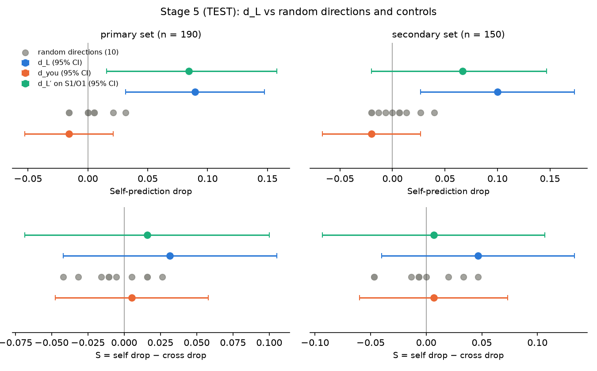

# Stage 5 report — held-out TEST evaluation and decision rule, 2026-11-09

**Decision (primary analysis, mechanical rule): Refine.** Criteria (a), (b), (d) and (e) pass; (c) fails, because
the selective measure S has a 95% CI that includes 0 (S = +0.032 [−0.042, 0.105]). The effect is not fragile across
wordings. The secondary (non-factual) set also gives Refine, and the cross-as-self diagnostic falls as much as
self-prediction does.

L = 12 and α = 2.0 were read from `stage3_selection.json` (frozen 2026-11-09T11:26:09Z); d_L, d_L′ and d_you are the
dev-fit directions saved in `stage3_directions.pt`; random directions use seeds 1–10 exactly as in Stage 4. Nothing
was fitted, selected or re-run on test before this stage, and nothing was changed after seeing test results.

Files: `scripts/stage5_test.py`; `results/stage5_test_raw.csv` (per item × condition, with Gemma's answers),
`stage5_test_metrics.json`, `stage5_run.json`, `stage5_log.txt`, `stage5_random_distribution.png`. Every number below
comes from these files, except section 5's diagnostics, which were computed afterwards from `stage5_test_raw.csv`.

## 1. What was run
- **Items:** the 190 test items carrying first_letter (choice 100, completion 50, factual 40); secondary set = the
  150 non-factual items (Amendment 3). All A and B object answers had a valid first letter (190/190 eligible in every
  condition).
- **Gemma (B, never hooked):** object answers and S1 self-predictions on test (380 generations). B was then freed.
- **Qwen (A):** the Stage 2 baseline on test (object answers; S1, O1, S2, O2), then every Stage 4 condition with the
  same code (`interventions.py`, `stage4_interventions.criteria`): d_L (also scored on S2/O2 = paraphrase), d_you,
  d_L′ scored on S1/O1 (transfer), random_1–10. Factual accuracy on the 40 test factual items and neutral-text
  perplexity (Stage 2 procedure) under every hook. Greedy, cached, bf16, batch size 1.
- **Scoring** as in Stage 4: self = S1 vs A's own answer in that condition; cross = O1 vs Gemma's test answer;
  cross-as-self = O1 vs A's own answer in that condition. Drops = baseline − condition. S = self drop − cross drop.
  Paired bootstrap over items, 10,000 resamples, seed 0, percentile 95% CIs.
- **Paraphrase-fragility rule**, written into the script before it ran (the protocol does not define it
  operationally): fragile if the d_L self drop on S2/O2 has a 95% CI lower bound ≤ 0.

## 2. Test baseline (Stage 2-style numbers; information only, they gate nothing)
| | Test | Dev (Stage 2) |
|---|---|---|
| Self S1 [95% CI] | 0.447 [0.379, 0.521] | 0.442 [0.374, 0.511] |
| Cross O1 | 0.321 [0.258, 0.389] | 0.326 [0.263, 0.395] |
| Self − cross (paired) | +0.126 [0.058, 0.200] | +0.116 [0.053, 0.179] |
| Self S2 / cross O2 | 0.453 / 0.347 (diff +0.105 [0.042, 0.174]) | 0.411 / 0.326 |
| Majority / freq.-random baseline (A's targets) | 0.111 / 0.065 | 0.095 / 0.065 |
| Gate-1-style check (lower bound > majority, n ≥ 40) | would pass (0.379 > 0.111) | passed |
| A and B give the same first letter | 0.637 | 0.558 |
| A's S1 and O1 predictions identical | 0.711 | 0.747 |
| O1 scored against A's own answer | 0.358 | 0.389 |
| B predicting B (S1, exploratory) | 0.532 [0.463, 0.605] | 0.521 |
| Self accuracy by category: choice / completion / factual | 0.39 / 0.20 / 0.90 | — |
| A factual accuracy (n = 40) / B | 0.950 / 1.000 | 0.950 / 1.000 |
| A perplexity (neutral text) | 13.887 | 13.887 |

Validity: A self 0.989, cross 0.995; object validity 1.000 (A and B). A noncompliant (multi-word) answers 9.5%.
The self-simulation pattern from Stage 2 replicates on test: A gives the same prediction for itself and for "Gemma"
on 71% of items.

## 3. Results — primary set (190 test items)
| Condition | Self acc | Cross acc | Self drop [95% CI] | Cross drop [95% CI] | **S** [95% CI] | Cross-as-self | Factual | PPL (rise) | Answer change | Mean \|h·d\| |
|---|---|---|---|---|---|---|---|---|---|---|
| Baseline | 0.447 | 0.321 | — | — | — | 0.358 | 0.950 | 13.89 | — | 5.76 (d_L, unedited) |
| **d_L** | **0.358** | 0.263 | **+0.089** [0.032, 0.147] | +0.058 [0.021, 0.100] | **+0.032** [−0.042, 0.105] | 0.263 | 0.950 | 13.98 (+0.6%) | 0.27 | 5.76 |
| Random ×10: range | 0.416–0.463 | 0.289–0.337 | −0.016 to +0.032 | −0.016 to +0.032 | −0.042 to +0.026 | 0.337–0.368 | 0.950–0.975 | 13.84–14.31 (≤ +3.0%) | 0.06–0.27 | 0.97–6.48 |
| Random ×10: mean | | | +0.004 | +0.009 | −0.005 | | | | 0.10 | 2.17 |
| d_you | 0.463 | 0.342 | −0.016 [−0.053, 0.021] | −0.021 [−0.063, 0.021] | +0.005 [−0.047, 0.058] | 0.379 | 0.975 | 13.85 (−0.3%) | 0.10 | 2.14 |
| d_L′ on S1/O1 (transfer) | 0.363 | 0.253 | +0.084 [0.016, 0.158] | +0.068 [0.021, 0.116] | +0.016 [−0.068, 0.100] | 0.253 | 0.975 | 14.74 (+6.2%) | 0.37 | 8.49 |
| Baseline, S2/O2 | 0.453 | 0.347 | — | — | — | 0.400 | 0.950 | 13.89 | — | — |
| d_L, S2/O2 (paraphrase) | 0.342 | 0.342 | +0.111 [0.058, 0.163] | +0.005 [−0.016, 0.026] | +0.105 [0.053, 0.158] | 0.337 | 0.950 | 13.98 (+0.6%) | 0.27 | 5.76 |

Cross-as-self drop under d_L: **+0.095 [0.047, 0.142]**; self drop − cross-as-self drop = **−0.005 [−0.063, 0.053]**.
The first letter of A's object answer changed on 19.5% of items under d_L (random 2.1–15.8%, d_you 4.7%).
Prediction validity under d_L: self 0.984, cross 0.968 (random 0.984–0.995). The amount removed per position is
α × mean |h·d| (11.5 for d_L). The largest random projection (random_5, |h·d| 6.48) changes 27% of object answers,
like d_L, but its self drop is −0.016 and its S −0.042.

## 4. Results — secondary set (150 non-factual test items)
| Condition | Self acc | Cross acc | Self drop [95% CI] | Cross drop [95% CI] | **S** [95% CI] | Cross-as-self | Answer change |
|---|---|---|---|---|---|---|---|
| Baseline | 0.327 | 0.193 | — | — | — | 0.240 | — |
| **d_L** | **0.227** | 0.140 | **+0.100** [0.027, 0.173] | +0.053 [0.007, 0.100] | **+0.047** [−0.040, 0.133] | 0.140 | 0.34 |
| Random ×10: range | 0.287–0.347 | 0.160–0.207 | −0.020 to +0.040 | −0.013 to +0.033 | −0.047 to +0.047 | 0.220–0.260 | 0.07–0.33 |
| Random ×10: mean | | | +0.003 | +0.006 | −0.003 | | 0.12 |
| d_you | 0.347 | 0.220 | −0.020 [−0.067, 0.027] | −0.027 [−0.073, 0.020] | +0.007 [−0.060, 0.073] | 0.273 | 0.12 |
| d_L′ on S1/O1 | 0.260 | 0.133 | +0.067 [−0.020, 0.147] | +0.060 [0.007, 0.113] | +0.007 [−0.093, 0.107] | 0.133 | 0.46 |
| Baseline, S2/O2 | 0.333 | 0.207 | — | — | — | 0.280 | — |
| d_L, S2/O2 | 0.200 | 0.200 | +0.133 [0.073, 0.200] | +0.007 [−0.020, 0.033] | +0.127 [0.067, 0.193] | 0.200 | 0.34 |

Factual accuracy, perplexity and |h·d| are model-level, as in section 3. Cross-as-self drop under d_L:
+0.100 [0.047, 0.160]; self drop − cross-as-self drop = 0.000 [−0.067, 0.073]. In this set d_L's S (7/150 = 0.047)
**ties** random_8's S (also 7/150), so "S above all 10 random S" does not hold here.

## 5. Decision rule applied to the PRIMARY test results (protocol + Amendment 1)
| Criterion | Number | Result |
|---|---|---|
| (a) self drop under d_L, 95% CI excludes 0 | +0.089 [0.032, 0.147] | **pass** |
| (b) self drop larger than all 10 random drops | 0.089 vs max random 0.032 (random_8); rank 1 of 11 | **pass** |
| (c) (Amendment 1) CI of S excludes 0 **and** S(d_L) > all 10 random S | S +0.032 [−0.042, 0.105] → CI includes 0; S > all random holds (max random +0.026) | **fail** |
| (d) factual drop ≤ 5 pts and perplexity rise ≤ 10% | 0.0 pts (0.950 → 0.950); +0.6% (13.887 → 13.975) | **pass** |
| (e) d_you self drop < half the d_L self drop | −0.016 < 0.045 | **pass** |
| Paraphrase fragility (Amendment 1) | d_L on S2/O2: self drop +0.111 [0.058, 0.163]; S +0.105 [0.053, 0.158] | **not fragile** |

(a) and (b) hold and (c) fails → **Refine** (protocol: "(a) and (b) hold, but (c), (d) or (e) fails").

Secondary set, reported alongside (does not decide): (a) pass (+0.100 [0.027, 0.173]); (b) pass (max random 0.040);
(c) fail (S +0.047 [−0.040, 0.133]; and it only ties the largest random S); (d) pass; (e) pass (−0.020 < 0.050);
not fragile (+0.133 [0.073, 0.200]). Same pattern: Refine.

## 6. Diagnostics (not part of the decision rule)
1. **Cross-as-self moves with self.** Under d_L, A's O1 predictions scored against A's own answers lose as much as
   its S1 predictions (primary 0.095 vs 0.089; secondary 0.100 vs 0.100; both difference CIs include 0). This
   replicates dev (0.105 vs 0.105). Under Amendment 3 this means the effect is **not specific to the self-framing**:
   d_L affects how well A's predictions in either frame match A's own answers.
2. **Scoring asymmetry.** The self target moves with the intervention (A's regenerated answer); the cross target is
   Gemma's fixed answer. On the 37 items whose first letter changed under d_L, self accuracy fell 0.324 → 0.162
   (cross-as-self 0.297 → 0.027); on the 153 unchanged items it fell 0.477 → 0.405. Cross accuracy also fell on test
   (+0.058, CI above 0; dev +0.047), and the self drop was a little smaller (0.089 vs 0.105); together these
   shrink S from +0.058 (dev) to +0.032 (test).
3. **The paraphrase result is the strongest-looking number, and it is also ambiguous.** With the S2/O2 wording the
   cross drop is near zero, so S is +0.105 with a CI above 0, on dev and test alike. But the O2 frame names no model
   ("another AI assistant"), and cross-as-self still drops there (0.400 → 0.337, drop +0.063 [0.011, 0.116]);
   self drop − cross-as-self drop is +0.047 [0.000, 0.095], at the edge of 0. So in the paraphrase, too, much of
   the effect is A's answers moving away from what A predicts in either frame.
4. **Completion echoes.** Using a simple post-hoc rule (multi-word answer whose first word repeats the phrase's first
   word), A echoes the phrase in 14/50 test completion answers at baseline and 3/50 under d_L; the completion first
   letter changes on 36% of items and completion self accuracy falls 0.20 → 0.06. (The same rule gives 18 → 0 on dev,
   not exactly the 20 → 2 quoted in Stage 4, which used a different count.) Choice items: self 0.39 → 0.31;
   factual items: 0.90 → 0.85, no first-letter changes.
5. **d_L′** (fitted on S2/O2) again lowers self and cross by similar amounts (S near 0) and costs +6.2% perplexity.
6. **d_you** has no effect (self and cross both rise slightly), but its mean projection is 2.7× smaller than d_L's,
   so passing (e) is partly a smaller edit.

## 7. Dev vs test (primary)
| | Dev (Stage 4) | Test (Stage 5) |
|---|---|---|
| Self drop under d_L | +0.105 [0.047, 0.163] | +0.089 [0.032, 0.147] |
| Cross drop | +0.047 [0.011, 0.084] | +0.058 [0.021, 0.100] |
| S | +0.058 [−0.005, 0.121] | +0.032 [−0.042, 0.105] |
| Max random self drop / S | +0.026 / +0.032 | +0.032 / +0.026 |
| Cross-as-self drop | +0.105 | +0.095 |
| d_you self drop | +0.021 | −0.016 |
| Paraphrase self drop / S | +0.074 / +0.068 [0.011, 0.132] | +0.111 / +0.105 [0.053, 0.158] |
| Rule pattern | Refine (indicative) | **Refine** |

The self drop and its rank against random directions replicate on held-out items; S shrinks and stays
indistinguishable from 0.

## 8. Run facts and checks
- 9,120 generations (B 380; A 8,740), 638.9 s wall-clock, peak VRAM 15.9 GB (B), 10.0 GB (A). One model at a time.
- Baseline perplexity under the measure-only hook is 13.887, identical to Stage 2–4; d_L's |h·d| on test (5.76) and
  perplexity (13.975) match dev, as they should (perplexity does not depend on the items).
- No test-split re-run, no parameter change, no re-fitting. The script asserts (L, α) = (12, 2.0) before running.

## 9. Caveats
Zero-shot, one hooked model, one B model, first_letter only, n = 190 / 150 (one item = 0.5–0.7 points), greedy bf16
decoding, ten random directions (a coarse null: "larger than all 10" is p ≈ 1/11 at best). Completion targets measure
the echoed word when A echoes the phrase. A selective effect would be evidence about a causal contribution of this
direction to self-prediction; nothing here concerns self-awareness, subjective experience or consciousness.
